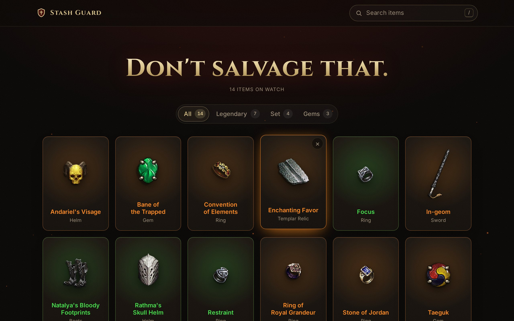
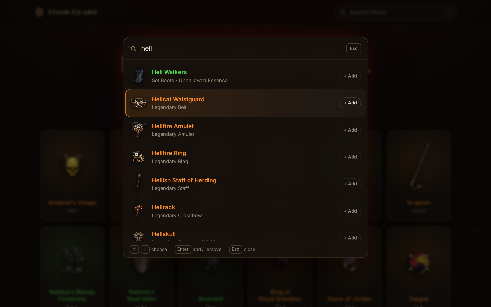
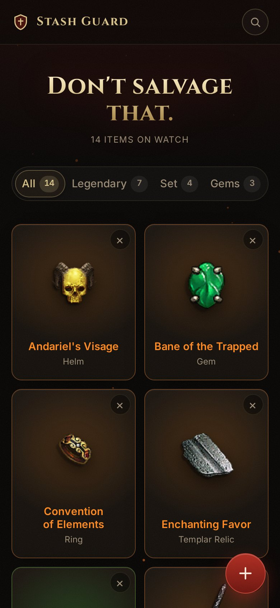
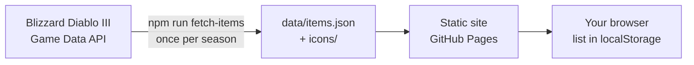

<div align="center">

# 🛡️ Stash Guard

### Don't salvage that.

Keep a list of the Diablo III legendaries, set items and legendary gems you're hunting,<br>
with their icons and in-game colours, so you recognise them the moment they drop.

**[Open Stash Guard →](https://florianvdab.github.io/stash-guard/)**



</div>

## Features

- **Every item worth keeping.** 891 legendaries, set items (follower items included) and legendary gems, with their original icons.
- **Search that stays out of the way.** Press <kbd>/</kbd>, <kbd>Ctrl</kbd>+<kbd>K</kbd> or just start typing. Arrow keys and <kbd>Enter</kbd> add items without touching the mouse, and the search stays open so you can add a whole build in one go.
- **Recognise drops at a glance.** Orange for legendary, green for set, the same colours you see in game.
- **Filter** your list by legendary, set or gem.
- **Private by design.** No account, no tracking, no server. Your list lives in your browser; export it to a file as a backup or to move it to another browser.
- **Works on your phone** next to the game, with a full-screen search and a thumb-sized add button.

<table>
  <tr>
    <td width="68%"></td>
    <td></td>
  </tr>
</table>

### Keyboard

| Key | Does |
| --- | --- |
| <kbd>/</kbd>, <kbd>Ctrl</kbd>+<kbd>K</kbd> or any letter | Open search |
| <kbd>↑</kbd> <kbd>↓</kbd> | Choose a result |
| <kbd>Enter</kbd> | Add or remove the chosen item |
| <kbd>Esc</kbd> | Close search |

## How it works



The site is plain HTML, CSS and JavaScript modules with no build step and no runtime dependencies.
A small Node script reads the item catalogue from the Blizzard API and saves it, together with every icon, into the repo.
Visitors never talk to Blizzard: the API credentials stay on the machine that runs the script.

## Run it locally

```sh
git clone https://github.com/Florianvdab/stash-guard.git
cd stash-guard
npm install        # dev tooling + the pre-push hook
npm run serve      # http://localhost:8099
```

## Refresh the item data

When a new season adds items:

1. Create a client on [develop.battle.net](https://develop.battle.net/access/clients).
2. Put its credentials in `.env` (git-ignored, never committed):
   ```
   CLIENT_ID=...
   CLIENT_SECRET=...
   ```
3. Run `npm run fetch-items`. It takes about a minute, caches item details in `.cache/` and downloads new icons into `icons/`.

## Code standard

This project follows Clean Code, and the tooling holds it to that:

- **ESLint** enforces small functions (≤ 20 lines, ≤ 3 parameters), shallow nesting and low complexity.
- **Unit tests** (`node --test`) describe all the logic: search, the list, backups, shortcuts and the item rules.
- **A secret scan** fails if `.env` or any of its values ends up in git.
- **A pre-push hook** runs all of the above (`npm run check`), so nothing unchecked reaches `main`.

Logic, browser side effects and DOM rendering live in separate modules. See [CLAUDE.md](CLAUDE.md) for the full standard and the review checklist.

## Credits

Item data and icons © Blizzard Entertainment, from the [Diablo III Game Data API](https://develop.battle.net/documentation/diablo-3/game-data-apis).
Stash Guard is a fan project and is not affiliated with or endorsed by Blizzard Entertainment.
